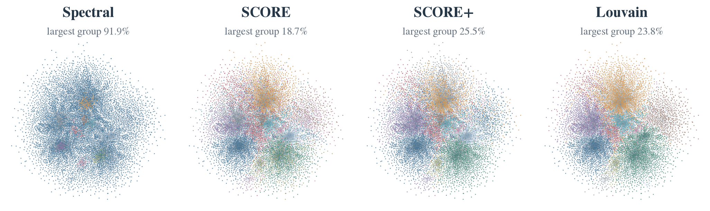

# Do Social Circles Share Music Taste?

**Comparing four community detection methods on LastFM Asia**

STAT 236 · Fall 2026 · Faye Fang and Grace Chen

[Analysis notebook](STAT236_LastFM_Community_Music.ipynb) · [Interactive page](html/index.html)

We draw social circles from mutual follows alone, then ask whether the people inside a circle share more liked artists than people in different circles. Spectral clustering, SCORE, SCORE+, and Louvain each return 11 circles on the same network. Music lists and country labels are used only after the circles are fixed.



*The same follow network and 11 circles per method. Spectral places 91.9% of users in one circle. SCORE, SCORE+, and Louvain produce more balanced partitions.*

**7,431 users · 27,045 social ties · 7,842 artists · 18 country labels**

## Main findings

- With equal weight on each circle, within-circle Jaccard similarity is 25% to 54% higher than between-circle similarity for all four methods.
- With equal weight on each user pair, SCORE, SCORE+, and Louvain stay positive. Spectral moves from `T_eq = 0.0468` to `T_pair = -0.0137`. Its largest circle supplies 99.92% of within-circle pairs.
- Shuffles within country reproduce 37% to 72% of `T_eq`. Matching country, degree, and list length as well leaves a positive excess for every method.
- NMI is 0.13 to 0.15 between Spectral and the other methods, and 0.58 to 0.64 among SCORE, SCORE+, and Louvain.

The four Holm-adjusted p-values are **0.002**, the smallest value this test can return with 1,999 shuffles. Equal p-values do not imply equal effect sizes. The country shares are a comparison baseline, not a causal contribution. The data have no true circle labels, so the results describe association for these partitions.

## Reproduce

The notebook `STAT236_LastFM_Community_Music.ipynb` contains the analysis and its saved outputs. The saved run uses Python 3.12.3. Package versions are pinned in [requirements.txt](requirements.txt).

```bash
python3.12 -m venv .venv
.venv/bin/python -m pip install -r requirements.txt
.venv/bin/jupyter notebook STAT236_LastFM_Community_Music.ipynb
```

Start Jupyter from the repository root and run the cells in order. A full run writes figures to `output/figures/` and tables to `output/tables/`. The default seed is 236. Louvain's resolution is chosen with seeds 236 through 240. Set `STAT236_QUICK=1` for a shorter check that writes to `tmp/quick_output/`. The reported numbers use the full permutation counts.

The interactive page is `html/index.html`. It loads `style.css`, `data.js`, `app.js`, and the two figures in `html/figures/`, so keep the `html/` folder together when you open or copy it.

## Repository

```text
.
├── STAT236_LastFM_Community_Music.ipynb
├── html/
│   ├── index.html                       # interactive page
│   ├── style.css                        # page styles
│   ├── app.js                           # scroll steps and interactive figures
│   ├── data.js                          # numbers the page draws from
│   └── figures/                         # data_summary.png, coordinate_views.png
├── requirements.txt
├── data/                                # network, artists, country labels
└── output/                              # notebook figures, tables, and partitions
```

## Data and references

The data match the [SNAP LastFM Asia description](https://snap.stanford.edu/data/feather-lastfm-social.html): a March 2020 snapshot with 7,624 users and 27,806 mutual-follow edges. We drop 173 users with an empty artist list, then 20 users outside the largest connected component. A like is a mark, not a play count. Artist identities and country codes are anonymized.

- Rozemberczki and Sarkar (2020), [Characteristic Functions on Graphs](https://doi.org/10.1145/3340531.3411866).
- Jin (2015), [Fast Community Detection by SCORE](https://arxiv.org/abs/1211.5803).
- Jin, Ke and Luo (2022), [Improvements on SCORE, Especially for Weak Signals](https://arxiv.org/abs/1811.05927).
- Karrer and Newman (2011), [Stochastic Blockmodels and Community Structure in Networks](https://arxiv.org/abs/1008.3926).
- Blondel et al. (2008), [Fast Unfolding of Communities in Large Networks](https://arxiv.org/abs/0803.0476).
- Phipson and Smyth (2010), [Permutation P-values Should Never Be Zero](https://gksmyth.github.io/pubs/PermPValuesPreprint.pdf).
